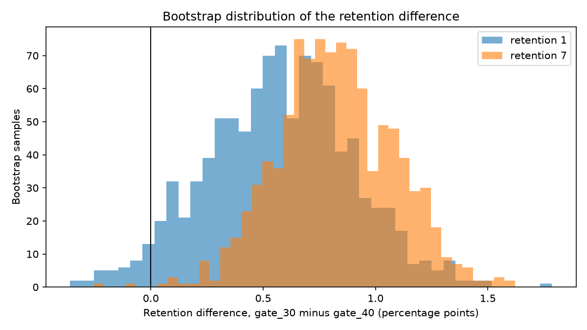
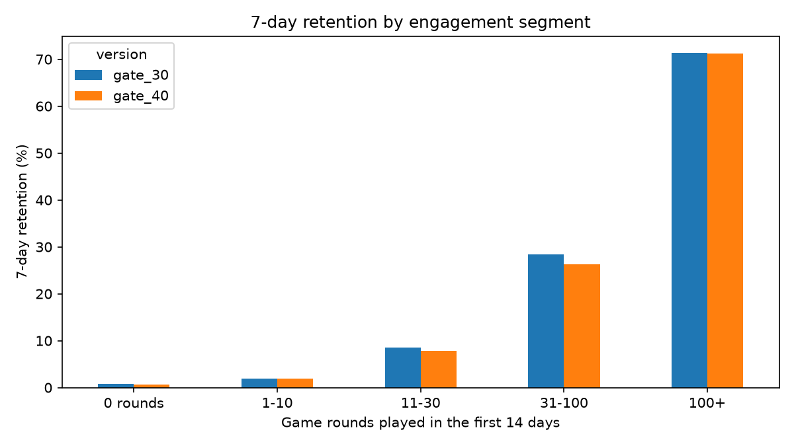

# Cookie Cats A/B Test: Player Retention Analysis

Cookie Cats is a mobile puzzle game by Tactile Entertainment. Players hit "gates" where they have to wait or pay before playing on. In this A/B test, about 90,000 new players were split into two groups: the first gate stayed at level 30 for one group and moved to level 40 for the other. I analysed whether the move changed how many players came back 1 day and 7 days after installing.

## Result

Keep the gate at level 30. Moving it to level 40 lowered 7-day retention from 19.02% to 18.20%, a drop of 0.82 percentage points (95% bootstrap interval 0.33 to 1.32). The z-test gives p = 0.0016, and gate 30 came out ahead in 99.8% of bootstrap samples. Day-1 retention also fell slightly (44.82% to 44.23%), but that difference is not statistically clear (p = 0.074).

One possible explanation: an earlier gate gives players a break sooner, which may keep them from burning out in the first week.



## What the analysis does

1. Data checks. 90,189 players, no duplicate IDs and no missing values. One player with 49,854 game rounds in 14 days was removed as an impossible outlier.
2. Sample ratio check. A chi-square test checks the players were split 50/50. The split was 44,699 vs 45,489 (p = 0.009), a small but real imbalance. In a live setting I'd raise this with the team running the experiment before trusting the result fully.
3. Two-proportion z-tests on 1-day and 7-day retention.
4. Bootstrapping (1,000 resamples) to get a confidence interval for each difference and the chance that gate 30 is better.
5. Mann-Whitney U test on game rounds played, since that metric is heavily skewed (p = 0.051, no clear difference).
6. Segmentation of 7-day retention by how many rounds players played.



The gap shows up mainly in players who played 31-100 rounds (28.4% vs 26.2%). One caution: rounds played happens after players are assigned to a group, so the gate itself may affect which segment a player lands in. The segment view is useful for exploring, but the overall test is the result to rely on.

## Run it yourself

```bash
python -m venv .venv
.venv\Scripts\activate           # Mac: source .venv/bin/activate
pip install -r requirements.txt
python ab_test.py                # downloads the data, prints results, saves charts and results.md
pytest                           # runs the unit tests
```

## Files

- `ab_test.py`: the full analysis
- `results.md`: the numbers from the latest run
- `charts/`: the two charts above
- `tests/test_ab_test.py`: unit tests with small made-up data, run on every push by GitHub Actions

## Data

The public Cookie Cats dataset (userid, version, sum_gamerounds, retention_1, retention_7), first published for a DataCamp project. The script downloads it automatically.